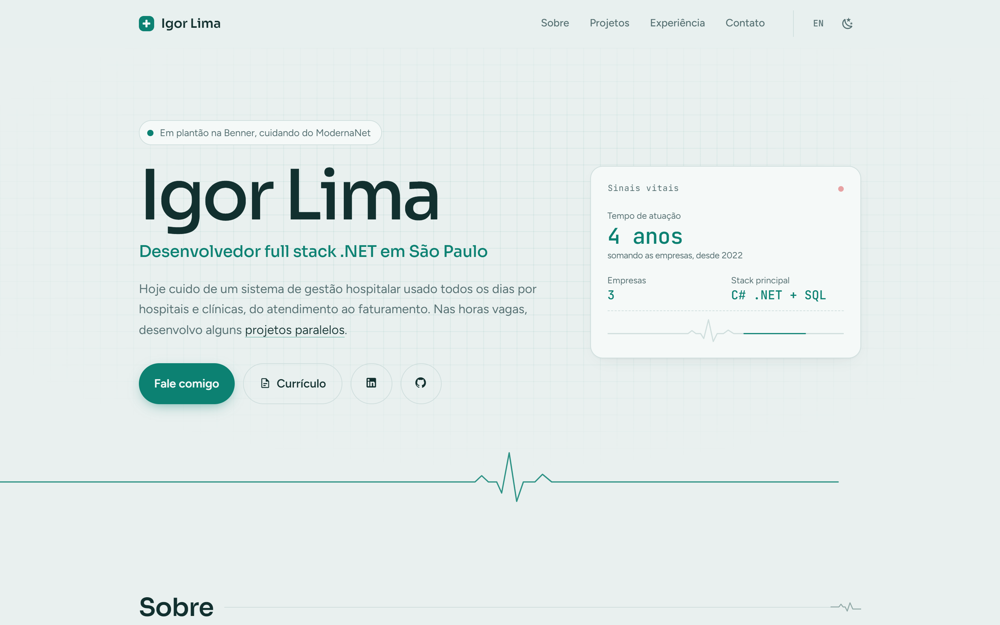
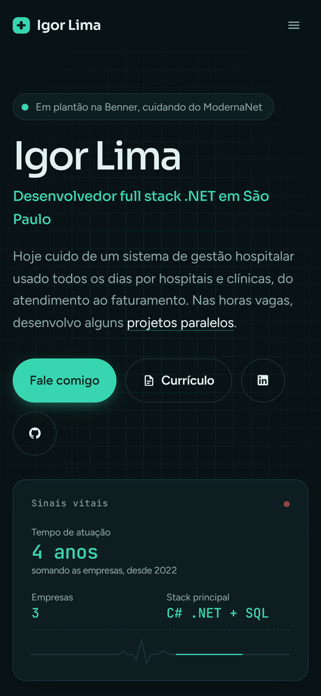

<div align="center">

# Igor Lima · Portfólio

Meu site pessoal, com minha experiência, projetos e currículo.

**[igorlima.dev](https://www.igorlima.dev)**

[](https://angular.dev)
[](https://www.typescriptlang.org)
[](https://www.igorlima.dev)

<picture>
  <source media="(prefers-color-scheme: dark)" srcset="docs/desktop-escuro.png">
  
</picture>

</div>

## Sobre

Sou desenvolvedor full stack .NET e trabalho com C# e SQL no ModernaNet, sistema de gestão para clínicas e hospitais da Benner. Esta é a terceira versão do portfólio, e o visual puxa um pouco desse universo de saúde, de um jeito sutil.



## Destaques

- Tema claro e escuro, que segue o sistema e lembra a escolha do visitante
- Português e inglês, com troca na hora
- Animações suaves que respeitam a opção "reduzir movimento" do sistema
- Tempo de atuação calculado sozinho a partir das datas de cada emprego
- Formulário de contato que envia e-mail direto, sem back-end
- Currículo em PDF para baixar
- Prévia do link pronta para LinkedIn, WhatsApp e outras redes
- Layout pensado para celular, tablet e computador

<br clear="right">

## Tecnologias

| Parte | Ferramentas |
| --- | --- |
| Front-end | Angular 17, TypeScript, SCSS |
| Traduções | ngx-translate |
| Contato | EmailJS |
| Avisos | ngx-toastr |
| Hospedagem | Vercel |

## Como rodar

Precisa do [Node.js](https://nodejs.org) 18.13 ou mais novo.

```bash
git clone https://github.com/eaiigor/portifolio-igor-lima.git
cd portifolio-igor-lima
npm install
npm start
```

O site abre em `http://localhost:4200`. Para gerar a versão de produção, use `npm run build`; os arquivos saem em `dist/`.

## Estrutura

```text
src/
├── app/
│   ├── components/   # seções da página: hero, sobre, projetos, experiência, contato
│   └── shared/
│       ├── jobs.ts               # lista de empregos (datas, links)
│       ├── duration.pipe.ts      # calcula o tempo de cada experiência
│       └── reveal.directive.ts   # faz as seções aparecerem ao rolar
├── assets/
│   ├── i18n/         # textos em português (pt.json) e inglês (en.json)
│   └── CV-IGOR-LIMA.pdf
└── styles.scss       # cores, fontes e estilos globais
```

Todo texto do site fica em `src/assets/i18n`. Para mudar uma frase, edite os dois arquivos, `pt.json` e `en.json`.

## Contato

- E-mail: [contato@igorlima.dev](mailto:contato@igorlima.dev)
- LinkedIn: [igor-rocha-lima](https://www.linkedin.com/in/igor-rocha-lima/)
- Site: [igorlima.dev](https://www.igorlima.dev)

---

<div align="center">Keep coding . . .</div>
